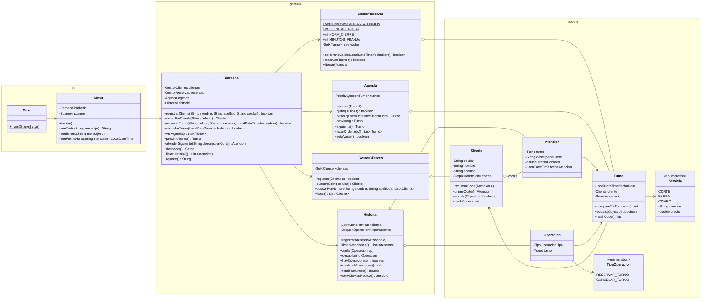

# Diseño – Diagrama de clases

Diagrama de clases del MVP de Barbería Digital. Un solo usuario (el barbero), solo turnos con reserva, horario de martes a sábado de 10 a 20 h en franjas de 30 minutos, datos en memoria.

## Paquetes

| Paquete | Para qué | Clases |
| --- | --- | --- |
| `ui` | Interacción por consola | `Main`, `Menu` |
| `gestion` | Lógica del negocio | `Barberia`, `GestorClientes`, `GestorReservas`, `Agenda`, `Historial` |
| `modelo` | Datos | `Cliente`, `Turno`, `Servicio`, `Atencion`, `Operacion`, `TipoOperacion` |

## Cómo se relacionan

- `Menu` solo habla con `Barberia`: pide los datos por consola y muestra los resultados.
- `Barberia` coordina cada acción: llama a los gestores que corresponden y apila las operaciones que se pueden deshacer. Los gestores no se conocen entre sí, así que se puede agregar funcionalidad sin tocar los otros módulos.
- Las clases de `modelo` no tienen lógica de negocio: guardan datos y definen cómo se comparan (`equals`, `hashCode`, `compareTo`).

## Qué hace cada clase en cada opción del menú

Recorrido completo de cada opción: desde que el barbero la elige en el menú hasta que ve el resultado.

### 0. Inicio del programa
| Paso | Clase | Método | Qué hace |
| --- | --- | --- | --- |
| 1 | `Main` | `main()` | Crea `Barberia` y `Menu` y llama a `menu.iniciar()` |
| 2 | `Barberia` | constructor | Crea `GestorClientes`, `GestorReservas`, `Agenda` e `Historial` vacíos |
| 3 | `Menu` | `iniciar()` | Muestra las opciones y lee la elegida, hasta que se elige 0 |

### 1. Registrar cliente
| Paso | Clase | Método | Qué hace |
| --- | --- | --- | --- |
| 1 | `Menu` | `leerTexto()` | Pide nombre, apellido y celular |
| 2 | `Barberia` | `registrarCliente(nombre, apellido, celular)` | Crea el `Cliente` y lo manda a registrar |
| 3 | `GestorClientes` | `buscarPorNombre()` | Busca coincidencias por nombre y apellido (aviso de posible duplicado) |
| 4 | `Cliente` | constructor | Crea el cliente con su pila de cortes vacía |
| 5 | `GestorClientes` | `registrar(cliente)` | Valida los datos y hace `add` al `Set`; `false` si el celular ya existe (lo detecta `Cliente.equals/hashCode`) |
| 6 | `Menu` | — | Muestra "Cliente registrado" o "El cliente ya está registrado" |

### 2. Reservar turno
| Paso | Clase | Método | Qué hace |
| --- | --- | --- | --- |
| 1 | `Menu` | `leerTexto()`, `leerEntero()`, `leerFechaHora()` | Pide celular, servicio y día y hora |
| 2 | `Barberia` | `reservarTurno(celular, servicio, fechaHora)` | Coordina la reserva |
| 3 | `GestorClientes` | `buscar(celular)` | Busca el cliente; si no existe, se registra (opción 1, pasos 1 a 5) |
| 4 | `GestorReservas` | `esHorarioValido(fechaHora)` | Martes a sábado, de 10:00 a 19:30, minutos 00 o 30 |
| 5 | `Turno` | constructor | Crea el turno con cliente, servicio y día y hora |
| 6 | `GestorReservas` | `reservar(turno)` | `add` al `Set<Turno>`; `false` si el horario está ocupado (lo detecta `Turno.equals/hashCode`) |
| 7 | `Agenda` | `agregar(turno)` | `add` a la `PriorityQueue` (se ordena con `Turno.compareTo`) |
| 8 | `Operacion` | constructor | Crea `Operacion(RESERVAR_TURNO, turno)` |
| 9 | `Historial` | `apilar(operacion)` | `push` en la pila de operaciones |
| 10 | `Menu` | — | Muestra "Turno confirmado", "Horario inválido" u "Horario ocupado" |

### 3. Cancelar turno
| Paso | Clase | Método | Qué hace |
| --- | --- | --- | --- |
| 1 | `Menu` | `leerFechaHora()` | Pide el día y la hora del turno a cancelar |
| 2 | `Barberia` | `cancelarTurno(fechaHora)` | Coordina la cancelación |
| 3 | `Agenda` | `buscar(fechaHora)` | Busca el turno; si no existe, informa "Turno no encontrado" |
| 4 | `Agenda` | `quitar(turno)` | `remove` de la `PriorityQueue` |
| 5 | `GestorReservas` | `liberar(turno)` | `remove` del `Set<Turno>`: el horario queda libre |
| 6 | `Historial` | `apilar(new Operacion(CANCELAR_TURNO, turno))` | `push` en la pila de operaciones |
| 7 | `Menu` | — | Muestra "Turno cancelado" |

### 4. Atender siguiente
| Paso | Clase | Método | Qué hace |
| --- | --- | --- | --- |
| 1 | `Barberia` | `proximoTurno()` | Pide el próximo turno sin sacarlo, para mostrarlo |
| 2 | `Agenda` | `proximo()` | `peek`: si no hay turnos, se informa "No hay turnos" y termina |
| 3 | `Cliente` | `ultimoCorte()` | `peek` de su pila: el menú muestra el turno y "lo de siempre" |
| 4 | `Menu` | `leerTexto()` | Pide la descripción del corte realizado |
| 5 | `Barberia` | `atenderSiguiente(descripcionCorte)` | Coordina la atención |
| 6 | `Agenda` | `siguiente()` | `poll`: saca el turno más próximo |
| 7 | `GestorReservas` | `liberar(turno)` | Libera el horario |
| 8 | `Atencion` | constructor | Crea la atención con turno, descripción, precio del `Servicio` y fecha |
| 9 | `Historial` | `registrarAtencion(atencion)` | Agrega al historial |
| 10 | `Cliente` | `registrarCorte(atencion)` | `push` en la pila de cortes del cliente |
| 11 | `Menu` | — | Muestra "Atención registrada" |

### 5. Ver agenda
| Paso | Clase | Método | Qué hace |
| --- | --- | --- | --- |
| 1 | `Barberia` | `verAgenda()` | Pide la agenda |
| 2 | `Agenda` | `listarOrdenado()` | Copia los turnos a una lista y la ordena por día y hora |
| 3 | `Turno` | `toString()` | Formatea cada turno |
| 4 | `Menu` | — | Muestra la lista o "No hay turnos" |

### 6. Consultar cliente y "lo de siempre"
| Paso | Clase | Método | Qué hace |
| --- | --- | --- | --- |
| 1 | `Menu` | `leerTexto()` | Pide el celular |
| 2 | `Barberia` | `consultarCliente(celular)` | Coordina la consulta |
| 3 | `GestorClientes` | `buscar(celular)` | Busca el cliente; si no existe, "Cliente no encontrado" |
| 4 | `Cliente` | `ultimoCorte()` | `peek` de la pila de cortes |
| 5 | `Menu` | — | Muestra los datos del cliente y su último corte, o "Sin cortes registrados" |

### 7. Historial y reporte
| Paso | Clase | Método | Qué hace |
| --- | --- | --- | --- |
| 1 | `Barberia` | `listarHistorial()` | Pide el historial |
| 2 | `Historial` | `listarAtenciones()` | Atenciones de la más reciente a la más antigua |
| 3 | `Barberia` | `reporte()` | Arma el texto del reporte |
| 4 | `Historial` | `cantidadAtenciones()`, `totalFacturado()`, `servicioMasPedido()` | Calcula los datos del reporte |
| 5 | `Servicio` | `getNombre()` | Nombre del servicio más pedido |
| 6 | `Menu` | — | Muestra el historial y el reporte (con historial vacío, todo en cero) |

### 8. Deshacer
| Paso | Clase | Método | Qué hace |
| --- | --- | --- | --- |
| 1 | `Barberia` | `deshacer()` | Coordina el deshacer |
| 2 | `Historial` | `hayOperaciones()` | Si la pila está vacía, informa "No hay operaciones para deshacer" |
| 3 | `Historial` | `desapilar()` | `pop`: saca la última operación |
| 4a | `Agenda` + `GestorReservas` | `quitar(turno)` + `liberar(turno)` | Si fue `RESERVAR_TURNO`: saca el turno de la agenda y libera el horario |
| 4b | `GestorReservas` + `Agenda` | `reservar(turno)` + `agregar(turno)` | Si fue `CANCELAR_TURNO`: vuelve a reservar el horario; si `reservar` da `false` (otro turno lo ocupó), informa que no se puede deshacer |
| 5 | `Menu` | — | Muestra qué se deshizo |

### Resumen: qué clases participan en cada opción
| Opción | `Menu` | `Barberia` | `GestorClientes` | `GestorReservas` | `Agenda` | `Historial` | Modelo |
| --- | --- | --- | --- | --- | --- | --- | --- |
| 1. Registrar cliente | ✔ | ✔ | ✔ | | | | `Cliente` |
| 2. Reservar turno | ✔ | ✔ | ✔ | ✔ | ✔ | ✔ | `Cliente`, `Turno`, `Servicio`, `Operacion` |
| 3. Cancelar turno | ✔ | ✔ | | ✔ | ✔ | ✔ | `Turno`, `Operacion` |
| 4. Atender siguiente | ✔ | ✔ | | ✔ | ✔ | ✔ | `Turno`, `Cliente`, `Atencion`, `Servicio` |
| 5. Ver agenda | ✔ | ✔ | | | ✔ | | `Turno` |
| 6. Consultar cliente | ✔ | ✔ | ✔ | | | | `Cliente`, `Atencion` |
| 7. Historial y reporte | ✔ | ✔ | | | | ✔ | `Atencion`, `Servicio` |
| 8. Deshacer | ✔ | ✔ | | ✔ | ✔ | ✔ | `Operacion`, `Turno` |

## Responsables del código

| Paquete de trabajo | Clases | Responsable |
| --- | --- | --- |
| Clientes y reservas (A, D, E) | `Cliente`, `Turno`, `GestorClientes`, `GestorReservas` | Martina |
| Menú y agenda (C, F, H) | `Main`, `Menu`, `Servicio`, `Agenda` | Kaiken |
| Atención e historial (G, B, I, J) | `Atencion`, `Operacion`, `TipoOperacion`, `Historial`, `Barberia` | Fabrizio |

## Detalle de cada clase

### Paquete `modelo`

#### `Cliente`
Representa a un cliente de la barbería. Su celular lo identifica.

| Atributo | Tipo | Descripción |
| --- | --- | --- |
| `celular` | `String` | Identificador único; no se modifica |
| `nombre` | `String` | Nombre |
| `apellido` | `String` | Apellido |
| `cortes` | `Deque<Atencion>` | Pila de cortes del cliente (`ArrayDeque`) |

| Método | Devuelve | Qué hace |
| --- | --- | --- |
| `Cliente(nombre, apellido, celular)` | — | Constructor; crea la pila de cortes vacía |
| getters | — | `getCelular()`, `getNombre()`, `getApellido()` |
| `registrarCorte(Atencion a)` | `void` | Apila el corte (`push`) |
| `ultimoCorte()` | `Atencion` | Devuelve el último corte (`peek`) o `null` si no tiene |
| `equals(Object o)` / `hashCode()` | `boolean` / `int` | Comparan por celular (para el `Set`) |
| `toString()` | `String` | "Juan Pérez (3515551234)" |

#### `Turno`
Un turno reservado: quién, qué servicio y cuándo.

| Atributo | Tipo | Descripción |
| --- | --- | --- |
| `fechaHora` | `LocalDateTime` | Día y hora del turno |
| `cliente` | `Cliente` | Cliente que reservó |
| `servicio` | `Servicio` | Servicio reservado |

| Método | Devuelve | Qué hace |
| --- | --- | --- |
| `Turno(fechaHora, cliente, servicio)` | — | Constructor |
| getters | — | `getFechaHora()`, `getCliente()`, `getServicio()` |
| `compareTo(Turno otro)` | `int` | Compara por fecha y hora (para la `PriorityQueue`); implementa `Comparable<Turno>` |
| `equals(Object o)` / `hashCode()` | `boolean` / `int` | Comparan por fecha y hora (para el `Set` de reservas) |
| `toString()` | `String` | "Mar 11/11 10:30 – Juan Pérez – Corte" |

#### `Servicio` (enum)
Servicios fijos de la barbería.

| Constante | Nombre | Precio |
| --- | --- | --- |
| `CORTE` | "Corte" | 8000 |
| `BARBA` | "Barba" | 5000 |
| `COMBO` | "Corte y barba" | 12000 |

| Método | Devuelve | Qué hace |
| --- | --- | --- |
| `getNombre()` | `String` | Nombre para mostrar |
| `getPrecio()` | `double` | Precio actual |

#### `Atencion`
Una atención ya realizada.

| Atributo | Tipo | Descripción |
| --- | --- | --- |
| `turno` | `Turno` | Turno atendido |
| `descripcionCorte` | `String` | Lo que hizo el barbero ("degradé bajo") |
| `precioCobrado` | `double` | Precio copiado del servicio al atender |
| `fechaAtencion` | `LocalDateTime` | Momento en que se registró |

| Método | Devuelve | Qué hace |
| --- | --- | --- |
| `Atencion(turno, descripcionCorte)` | — | Constructor; toma el precio del servicio y la fecha actual |
| getters | — | De todos los atributos |
| `toString()` | `String` | "Mar 11/11 10:00 – Juan Pérez – Corte – degradé bajo – $8000" |

#### `Operacion`
Una operación que se puede deshacer.

| Atributo | Tipo | Descripción |
| --- | --- | --- |
| `tipo` | `TipoOperacion` | Qué se hizo |
| `turno` | `Turno` | Turno afectado |

| Método | Devuelve | Qué hace |
| --- | --- | --- |
| `Operacion(tipo, turno)` | — | Constructor |
| getters | — | `getTipo()`, `getTurno()` |

#### `TipoOperacion` (enum)
`RESERVAR_TURNO`, `CANCELAR_TURNO`.

### Paquete `gestion`

#### `GestorClientes`
Administra los clientes registrados.

| Atributo | Tipo | Descripción |
| --- | --- | --- |
| `clientes` | `Set<Cliente>` | `HashSet`; no admite celulares repetidos |

| Método | Devuelve | Qué hace |
| --- | --- | --- |
| `registrar(Cliente c)` | `boolean` | Valida los datos y agrega; `false` si el celular ya existe |
| `buscar(String celular)` | `Cliente` | Busca por celular; `null` si no existe |
| `buscarPorNombre(nombre, apellido)` | `List<Cliente>` | Coincidencias por nombre (aviso de posible duplicado) |
| `listar()` | `List<Cliente>` | Todos los clientes |

#### `GestorReservas`
Valida horarios y controla que no se superpongan.

| Atributo | Tipo | Descripción |
| --- | --- | --- |
| `DIAS_ATENCION` | `Set<DayOfWeek>` (constante) | Martes a sábado |
| `HORA_APERTURA` | `int` (constante) | 10 |
| `HORA_CIERRE` | `int` (constante) | 20 |
| `MINUTOS_FRANJA` | `int` (constante) | 30 |
| `reservados` | `Set<Turno>` | `HashSet`; horarios tomados |

| Método | Devuelve | Qué hace |
| --- | --- | --- |
| `esHorarioValido(LocalDateTime fechaHora)` | `boolean` | Día de atención, entre 10:00 y 19:30, minutos 00 o 30 |
| `reservar(Turno t)` | `boolean` | Agrega al `Set`; `false` si el horario está ocupado |
| `liberar(Turno t)` | `void` | Saca el turno del `Set` |

#### `Agenda`
Turnos pendientes, ordenados por día y hora.

| Atributo | Tipo | Descripción |
| --- | --- | --- |
| `turnos` | `PriorityQueue<Turno>` | El próximo turno siempre queda primero |

| Método | Devuelve | Qué hace |
| --- | --- | --- |
| `agregar(Turno t)` | `void` | Agrega a la cola (`add`) |
| `quitar(Turno t)` | `boolean` | Saca un turno puntual (`remove`) |
| `buscar(LocalDateTime fechaHora)` | `Turno` | Busca el turno de ese día y hora; `null` si no hay |
| `proximo()` | `Turno` | Muestra el próximo sin sacarlo (`peek`) |
| `siguiente()` | `Turno` | Saca el próximo para atenderlo (`poll`) |
| `listarOrdenado()` | `List<Turno>` | Copia y ordena (la cola no se recorre en orden) |
| `estaVacia()` | `boolean` | Si no hay turnos pendientes |

#### `Historial`
Atenciones realizadas y operaciones para deshacer.

| Atributo | Tipo | Descripción |
| --- | --- | --- |
| `atenciones` | `List<Atencion>` | `ArrayList`; todas las atenciones |
| `operaciones` | `Deque<Operacion>` | `ArrayDeque` usada como pila |

| Método | Devuelve | Qué hace |
| --- | --- | --- |
| `registrarAtencion(Atencion a)` | `void` | Agrega al historial |
| `listarAtenciones()` | `List<Atencion>` | De la más reciente a la más antigua |
| `apilar(Operacion op)` | `void` | `push` |
| `desapilar()` | `Operacion` | `pop`; `null` si la pila está vacía |
| `hayOperaciones()` | `boolean` | Si hay algo para deshacer |
| `cantidadAtenciones()` | `int` | Para el reporte |
| `totalFacturado()` | `double` | Suma de `precioCobrado` |
| `servicioMasPedido()` | `Servicio` | El servicio que más se repite; `null` si no hay atenciones |

#### `Barberia`
Coordina a los gestores. Es la única clase que usa el menú. Los pasos de cada método están en la tabla "Qué hace `Barberia` en cada opción del menú".

| Atributo | Tipo |
| --- | --- |
| `clientes` | `GestorClientes` |
| `reservas` | `GestorReservas` |
| `agenda` | `Agenda` |
| `historial` | `Historial` |

### Paquete `ui`

#### `Menu`
Muestra el menú, lee los datos por consola y llama a `Barberia`.

| Método | Devuelve | Qué hace |
| --- | --- | --- |
| `iniciar()` | `void` | Bucle del menú hasta elegir 0 |
| `leerTexto(String mensaje)` | `String` | Pide un texto no vacío |
| `leerEntero(String mensaje)` | `int` | Pide un número; si no es válido, lo vuelve a pedir |
| `leerFechaHora(String mensaje)` | `LocalDateTime` | Pide día y hora (ej.: 11/11/2026 10:30) y valida el formato |

#### `Main`
Punto de entrada: crea `Barberia` y `Menu` y llama a `menu.iniciar()`.

## Diagrama

