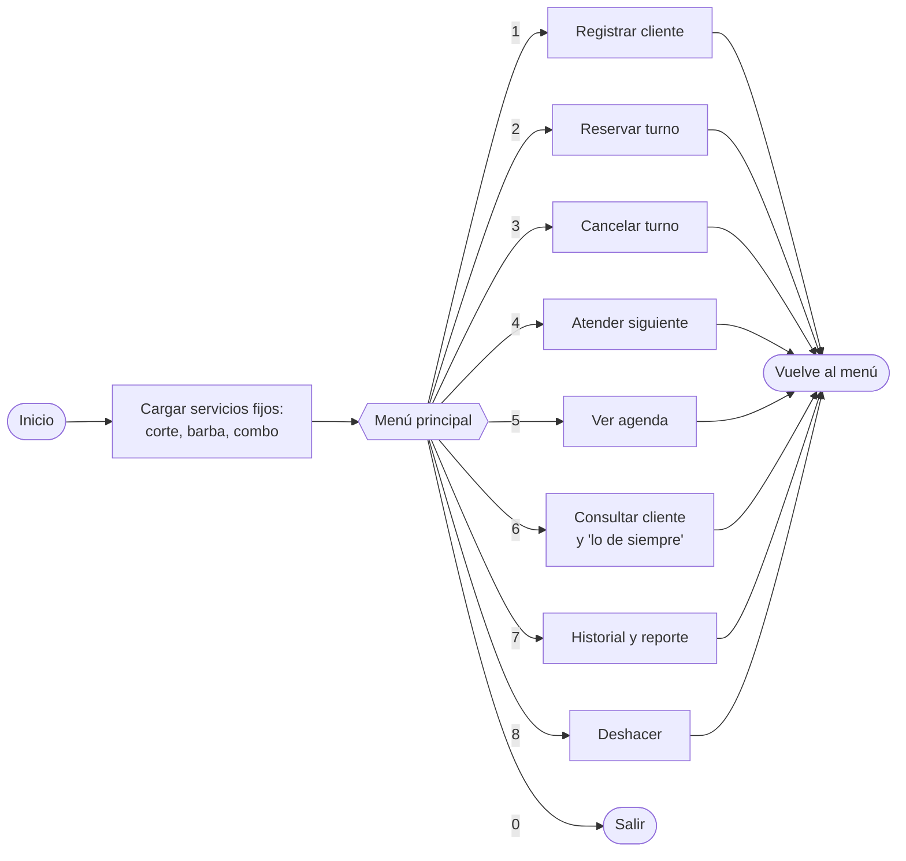
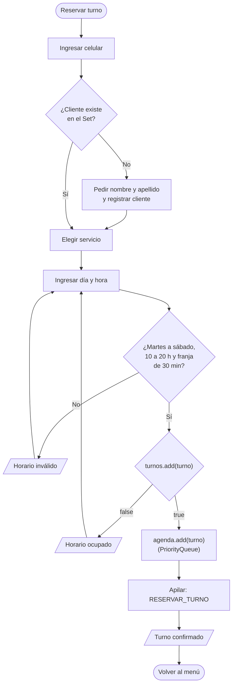
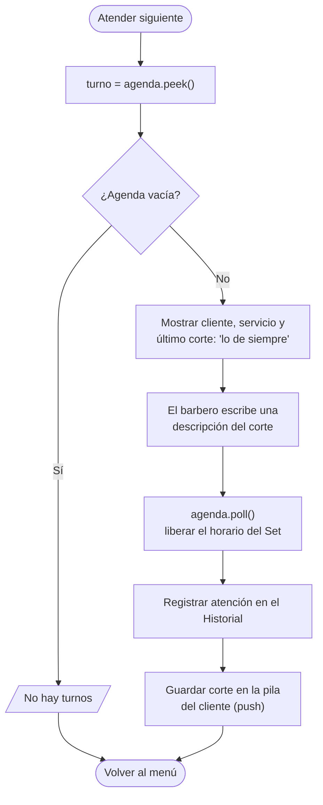
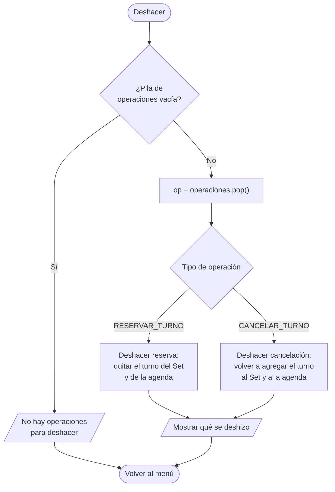

# Diseño – Diagramas de flujo

Flujos del MVP. Un solo usuario (el barbero), turnos con reserva, horario de martes a sábado de 10 a 20 h en franjas de 30 minutos.

## 1. Menú principal

## 2. Reservar turno

## 3. Atender siguiente

## 4. Deshacer

## Reglas que muestran los flujos

- **Reservar:** si el cliente no existe, se registra en el mismo paso (registrar no se puede deshacer). El horario se valida primero (día, rango y franja) y después se intenta agregar al `Set<Turno>`: si `add()` devuelve `false`, el horario está ocupado.
- **Atender siguiente:** primero `peek()` de la `PriorityQueue` para mostrar el turno más próximo y "lo de siempre" (`peek()` de la pila de cortes del cliente); después de cargar la descripción, `poll()` lo saca de la agenda.
- **Cancelar:** se busca el turno por día y hora, se quita del Set y de la agenda, y se apila `CANCELAR_TURNO`.
- **Deshacer:** revierte solo la última operación, y solo hay dos posibles:
  - Deshacer reserva → quitar el turno.
  - Deshacer cancelación → volver a agregar el turno.
- Atender y registrar cliente no se pueden deshacer.
